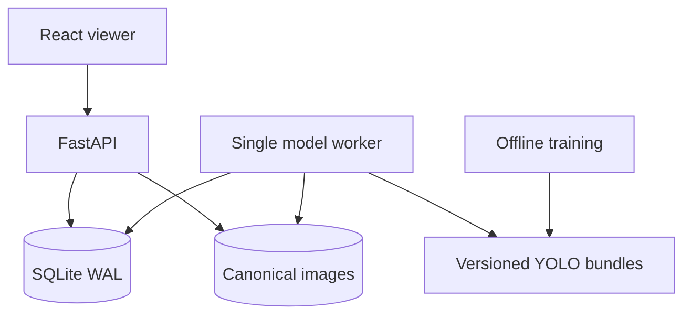

# Circuit Inspect

A local PCB inspection workbench: train a YOLO detector, upload a bare-board image, and review colored translucent regions around predicted defects. The viewer supports zoom/pan, class labels, adjustable opacity, human review, inspection history, and PNG/JSON export.

**Status:** initial implementation. The app and data pipeline are tested, and a real YOLO development bundle is installed locally. Its short subset training produced poor validation accuracy (F1=0), so every output requires manual review. Full-data training and representative camera-image evaluation remain necessary; this checkpoint demonstrates integration.

## Start on Windows

Requires Python 3.11+ and Node.js 22+. From this folder:

```powershell
./scripts/setup.ps1
./scripts/start.ps1
```

Open **http://127.0.0.1:8000**. The launcher starts one inference worker and the API, which also serves the built React app. Ctrl+C stops this session. Worker logs are in `data/logs/`.

If local PowerShell policy prevents running scripts, run the commands directly in two terminals:

```powershell
# Terminal 1
./.venv/Scripts/python.exe -m pcb_inspection.worker
# Terminal 2
./.venv/Scripts/python.exe -m uvicorn pcb_inspection.api:app --host 127.0.0.1 --port 8000
```

The app opens before a model exists, and explains the setup requirement. Inference is enabled when a valid PCB bundle is installed and the worker is online. Training and dataset preparation use explicit commands below.

For frontend development, run `npm.cmd --prefix frontend run dev` with the API on port 8000. The development server proxies `/api`; the production build uses one origin.

## Prepare DeepPCB

The upstream dataset is **for research use**. Its software LICENSE and its dataset-use conditions are distinct. Data and checkpoints are excluded from Git.

```powershell
git clone --depth 1 https://github.com/tangsanli5201/DeepPCB.git data/raw/DeepPCB
./.venv/Scripts/python.exe -m pcb_inspection.ml.prepare --source data/raw/DeepPCB --output data/processed/deeppcb --seed 42
```

Preparation validates source boxes and classes, checks duplicate image hashes, preserves the published test membership, and creates group-disjoint training and validation sets. The observed split is **802 train / 198 validation / 500 test**. The published test set shares source-board groups with training; see [the dataset audit](docs/dataset_report.md). Do not describe this as fully board-disjoint testing.

| App ID | Category | Upstream ID |
|---|---|---|
| 0 | Open circuit | 1 |
| 1 | Short circuit | 2 |
| 2 | Mouse bite | 3 |
| 3 | Spur | 4 |
| 4 | Spurious copper | 5 |
| 5 | Pin hole | 6 |

The paired cleaned templates are recorded as known-negative provenance, not counted as representative factory-good photographs. Missing labels are not treated as good boards.

## Train, evaluate, install

First verify the pipeline with a small run:

```powershell
./.venv/Scripts/python.exe -m pcb_inspection.ml.train --data data/processed/deeppcb/data.yaml --epochs 1 --fraction 0.05 --device cpu --project runs/pcb --name smoke
```

For the full nano baseline:

```powershell
./.venv/Scripts/python.exe -m pcb_inspection.ml.train --data data/processed/deeppcb/data.yaml --epochs 100 --batch 4 --device cpu --project runs/pcb --name baseline-nano
```

CPU training can take a long time. Use `--device 0` only with a working CUDA-capable PyTorch installation. The training metadata records the actual runtime and device. Use a new run name for each experiment.

Evaluate validation data and promote the checkpoint:

```powershell
./.venv/Scripts/python.exe -m pcb_inspection.ml.evaluate --weights runs/pcb/baseline-nano/weights/best.pt --data data/processed/deeppcb/data.yaml --split val --output runs/pcb/baseline-nano/validation.json --device cpu
./.venv/Scripts/python.exe -m pcb_inspection.ml.bundle --weights runs/pcb/baseline-nano/weights/best.pt --models models --model-id deeppcb-yolo26n-v1 --label 'DeepPCB YOLO26n' --metrics runs/pcb/baseline-nano/validation.json
```

Use the actual save directory printed by the trainer. Installed models are discovered automatically. Promotion checks checkpoint classes and creates an immutable directory with a weights checksum and inference profile. Historical jobs retain the original model and profile; retries reject changed bundles.

Select thresholds and model settings on validation. Keep the test split untouched until those decisions are frozen. False-alarm image rate requires an explicitly verified good-image set; it stays unmeasured when one is absent.

## What the colored regions mean

YOLO predicts boxes internally. The renderer draws an ellipse centered on each box with half-width/half-height radii. These are **approximate defect areas**. Opacity changes presentation; it does not change confidence or the saved inspection decision. PNG exports include every saved finding at the selected opacity. JSON includes the original predictions, model/profile snapshot and separate human reviews.

All coordinates use the saved, orientation-normalized original image. Rectangles are available as a diagnostic toggle. Learned pixel masks remain an optional future extension.

A completed empty result says “No defects detected.” Input errors, missing models, and inference failures produce explicit errors. This optical inspection does not certify electrical function.

## Architecture



- `src/pcb_inspection/ml/`: dataset audit/conversion, training, evaluation, bundle promotion.
- `src/pcb_inspection/`: image normalization, geometry, model adapter, durable queue, worker and API.
- `frontend/`: React/TypeScript interface and Canvas overlays.
- `tests/`: unit/integration fixtures and isolated browser-test service.
- `configs/`: reproducible training defaults.
- `docs/`: architecture, data audit, experiment notes and implementation status.
- `.github/workflows/ci.yml`: Python tests/lint and frontend tests/build.

The queue uses guarded attempt leases, 5-second heartbeats, and periodic stale-job reconciliation. Only queued work can be cancelled. Raw results and human feedback are stored separately. Results commit atomically in SQLite; PNGs are generated on demand from committed predictions.

Uploads are limited to JPG/PNG, 25 MiB, 40 MP and a 12000-pixel side. One worker handles inference; the queue holds at most 20 waiting jobs. Optional tiled profiles use bounded 640px windows and class-aware duplicate suppression; check seam warnings. Large whole-image inputs receive a scale warning. The default 640px DeepPCB crops use whole-image inference.

## Verify

```powershell
./scripts/verify.ps1
# Optional browser workflow test (uses an isolated test-only fixture detector)
cd frontend
npm.cmd run browser:install
npm.cmd run test:e2e
```

Browser tests exercise upload → inspection → region selection → review → export → history, plus mobile layout. Fixture detections test the application; they are not evidence of model accuracy. Real YOLO inference is checked separately during ML integration.

## GitHub

Repository destination: https://github.com/AngAndrei/PCB_Automated_Inspection

The initial implementation is prepared on `feat/inspection-app`. Downloaded datasets, checkpoints, generated inspections, IDE configuration and temporary agent notes are excluded from version control. GitHub Actions runs Python and frontend checks once the source is pushed.

The ChatGPT GitHub app is read-only; changing repository selection or reconnecting it does not enable code pushes. This was confirmed after repeated403 Resource not accessible by integration responses. See https://help.openai.com/en/articles/11145903-connecting-github-to-chatgpt.

This agent's sandbox also protects local `.git` metadata. Publish from an ordinary PowerShell terminal in this folder:

```powershell
git add .
git commit -m "Initial PCB inspection app"
git remote add origin https://github.com/AngAndrei/PCB_Automated_Inspection.git
git push origin HEAD:main
git push -u origin feat/inspection-app
```

At the time of these instructions no origin remote exists and the GitHub repository is empty. If origin has since been configured, inspect it with `git remote -v` before adding or changing it. Git Credential Manager may ask for browser sign-in. These commands publish the initial application to main and keep feat/inspection-app available for subsequent work. Future changes can use pull requests. The repository is currently empty; no force-push or source-file replacement is needed.

A Codex session with local Git write access can also perform publication. The ChatGPT GitHub app can then read the published source for review.

## Sources and limits

See the [researched architecture](docs/superpowers/plans/2026-11-12-pcb-defect-segmentation.md), [experiment workflow](docs/experiments.md), [model card](docs/model_card.md), and [limitations](docs/limitations.md). DeepPCB source: https://github.com/tangsanli5201/DeepPCB. Model implementation: https://docs.ultralytics.com/.

Ultralytics uses AGPL-3.0 or an enterprise license. This project’s application code is provided under AGPL-3.0; dataset conditions continue to apply independently. Check the applicable terms before commercial distribution.

## Reproducibility and privacy

The measured Windows CPU environment is pinned in `requirements-windows-cpu.lock.txt` (Python3.13). To reproduce it, install that file into a fresh environment, then install this project with `pip install -e . --no-deps`. The normal setup script resolves compatible versions for its Python runtime.

Model code sets `YOLO_OFFLINE=true` and `YOLO_AUTOINSTALL=false` before importing Ultralytics. Its sync/analytics and available cloud integrations are disabled. Inference uses local installed weights. Obtain dataset/checkpoint files explicitly before offline training; the official pretrained `yolo26n.pt` has already been downloaded here.

Promotion now binds evaluation to the exact checkpoint checksum and dataset version, preserves evaluated input size/confidence/NMS settings, and defaults to `unvalidated` manual review. Pass `--training-status development` for development models; `--training-status validated` is an explicit release decision after reviewing evaluation, not an automatic score threshold.
